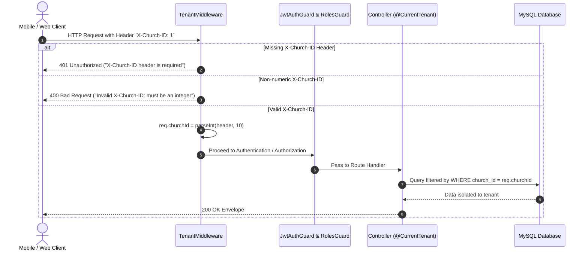
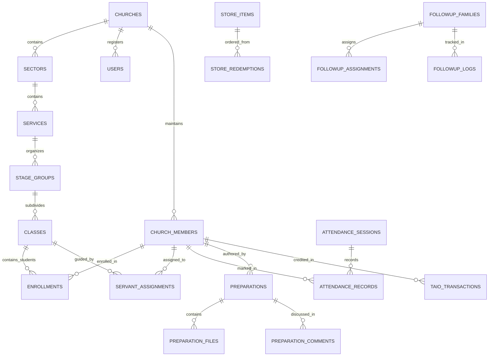
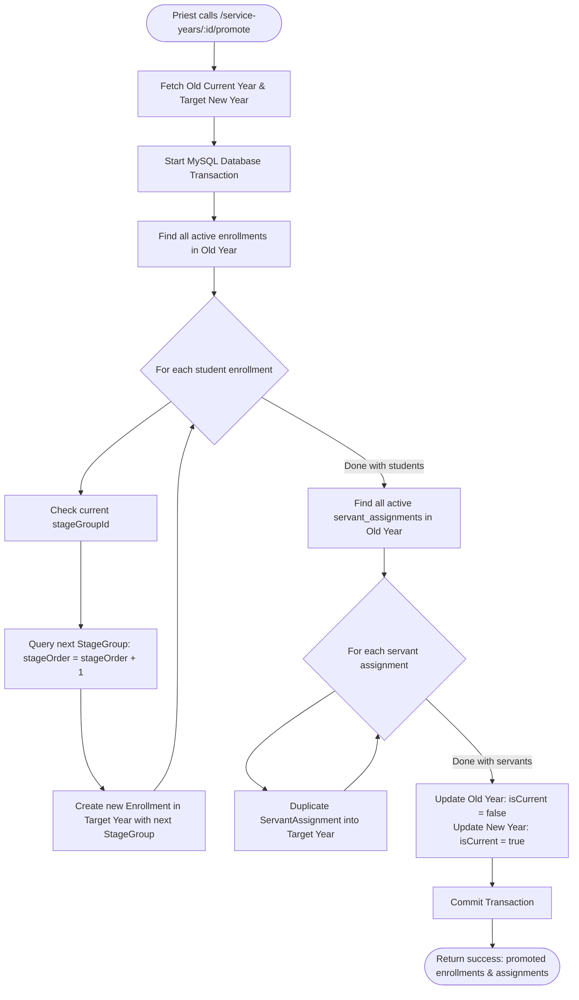
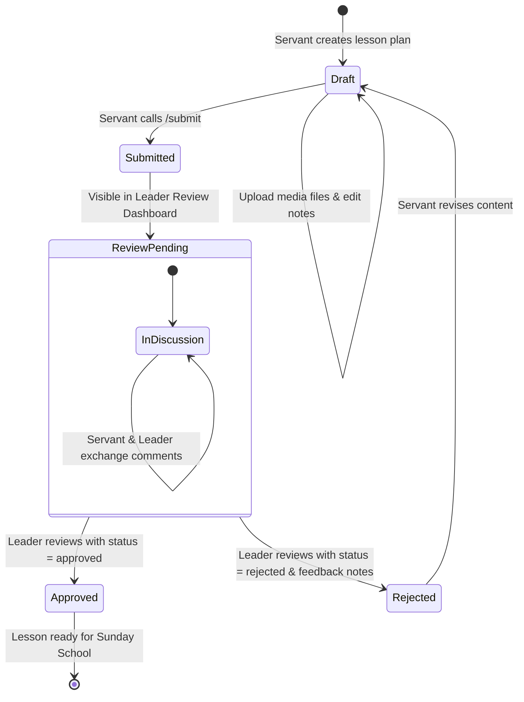

# Church Ministry Management System — Backend Architecture & Technical Guide

> **System Name:** Khedma App (خدمتي) — Church Ministry Management Platform  
> **Backend Type:** Multi-Tenant, Context-Aware RESTful API  
> **Core Framework:** NestJS 10, TypeScript 5.3, Sequelize 6 + sequelize-typescript  
> **Database:** MySQL 8 (InnoDB, utf8mb4_unicode_ci)  
> **Target Audience:** Backend Developers, Mobile/Frontend Engineers, QA Engineers, DevOps, System Architects  

---

## 1. Architectural Overview & Philosophy

The Khedma backend is a production-grade enterprise API engineered specifically for Orthodox Church Sunday School and pastoral ministry management. It bridges deep pastoral ecclesiastical hierarchies with modern cloud-native software architecture.

### 1.1 Key Architectural Tenets

1. **Strict Multi-Tenancy**:
   - The platform supports multiple churches on a shared database.
   - Every tenant-scoped table enforces a `church_id` foreign key.
   - Tenancy is resolved at the request gateway via `TenantMiddleware` reading the `X-Church-ID` header (or query param).
   - Tenant isolation is validated across every controller and service method via `@CurrentTenant()`.

2. **Context-Based Multi-Role Authorization (Role Switching without Re-login)**:
   - A single person in an Orthodox church frequently holds multiple simultaneous responsibilities (e.g., Sunday School Servant in 3rd Primary, Service Leader in Preparatory, and Parent of children in Kindergarten).
   - Instead of separate accounts or logging in and out, the user possesses multiple *Contexts*.
   - The active context (`role` + `scope`: `sectorId`, `serviceId`, `classId`) is embedded directly inside the signed JWT.
   - The user seamlessly switches active context via `POST /auth/switch-context`, obtaining an updated JWT instantly without credentials.

3. **Immutable Audit Ledger for Gamification (Taio Points)**:
   - Points are never stored merely as an incrementable integer column.
   - Every point awarded, deducted, or redeemed is an immutable row in `taio_transactions`.
   - The member's current balance is the transactional aggregate (`SUM(points)`), preventing corruption and enabling comprehensive auditing.

4. **Multi-Tier Pastoral Hierarchy**:
   - The system models the full church hierarchy:
     $$\text{Church} \longrightarrow \text{Sector (قطاع)} \longrightarrow \text{Service (خدمة)} \longrightarrow \text{Stage Group (مرحلة)} \longrightarrow \text{Class (فصل/أسرة)}$$
   - Servants and leaders are assigned at the exact tier corresponding to their responsibility.

5. **Soft Deletions Everywhere**:
   - Critical ministry records (members, enrollments, sessions, logs) utilize `deleted_at` timestamps to preserve historical reporting integrity across service years.

---

## 2. Technology Stack & Dependencies

```
┌───────────────────────────────────────────────────────────┐
│                       HTTP Client                         │
│             (Mobile App / Web Dashboard / Admin)          │
└─────────────────────────────┬─────────────────────────────┘
                              │ JSON / REST / X-Church-ID
                              ▼
┌───────────────────────────────────────────────────────────┐
│                    NestJS 10 Framework                    │
│  ┌───────────────────────┐     ┌───────────────────────┐  │
│  │   TenantMiddleware    │ ──→ │  ValidationPipe       │  │
│  └───────────────────────┘     └───────────────────────┘  │
│  ┌───────────────────────┐     ┌───────────────────────┐  │
│  │   JwtAuthGuard        │ ──→ │  RolesGuard           │  │
│  └───────────────────────┘     └───────────────────────┘  │
│  ┌───────────────────────┐     ┌───────────────────────┐  │
│  │   ContextGuard        │ ──→ │  AuditInterceptor     │  │
│  └───────────────────────┘     └───────────────────────┘  │
│  ┌───────────────────────┐     ┌───────────────────────┐  │
│  │ TransformInterceptor  │ ──→ │  HttpExceptionFilter  │  │
│  └───────────────────────┘     └───────────────────────┘  │
└─────────────────────────────┬─────────────────────────────┘
                              │
                              ▼
┌───────────────────────────────────────────────────────────┐
│           Sequelize ORM 6 + sequelize-typescript          │
│                (43 Models / Relations / Hooks)            │
└─────────────────────────────┬─────────────────────────────┘
                              │
                              ▼
┌───────────────────────────────────────────────────────────┐
│                  MySQL 8.0 Database                       │
│    (InnoDB, UUID PKs / AutoInc, Indexes, Transactions)     │
└───────────────────────────────────────────────────────────┘
```

| Layer | Package | Version | Purpose |
|---|---|---|---|
| **Core Framework** | `@nestjs/core`, `@nestjs/common` | `^10.3.0` | Dependency injection, module architecture, HTTP abstraction |
| **HTTP Engine** | `@nestjs/platform-express` | `^10.3.0` | Express HTTP server under NestJS |
| **Configuration** | `@nestjs/config`, `dotenv` | `^3.1.1` | Environment variable validation & centralized settings |
| **Authentication** | `@nestjs/jwt`, `@nestjs/passport`, `passport-jwt` | `^10.2.0` | JWT issuance, signing, Bearer token extraction |
| **Hashing & Security** | `bcrypt` | `^5.1.1` | Salted password hashing (10 rounds) |
| **Database ORM** | `@nestjs/sequelize`, `sequelize`, `sequelize-typescript` | `^11.0.1` / `^6.35.2` | Typed database models, associations, transactional queries |
| **Database Driver** | `mysql2` | `^3.7.0` | High-performance MySQL connection pool |
| **Database Migrations** | `sequelize-cli` | `^6.6.2` | Structured schema versioning and data seeding |
| **Validation** | `class-validator`, `class-transformer` | `^0.14.0` / `^0.5.1` | Strict runtime DTO parsing, whitelisting, sanitization |
| **Spreadsheets** | `exceljs` | `^4.4.0` | Native Excel (`.xlsx`) generation for complex ministry reports |
| **File Storage** | `multer`, `@types/multer` | `^1.4.5-lts.1` | Lesson preparation attachment uploads (PDFs, PPTs, Images) |
| **Static Serving** | `@nestjs/serve-static` | `^4.0.0` | Serving local uploaded files over `/uploads` route |
| **Documentation** | `@nestjs/swagger` | `^7.2.0` | OpenAPI specification generation |

---

## 3. Directory & File Structure

```
backend/
├── src/
│   ├── main.ts                         # Application bootstrapper (Prefix: api/v1, CORS, Pipes, Filters)
│   ├── app.module.ts                   # Root application module wiring all 18 modules & global providers
│   ├── config/
│   │   ├── environment.ts              # Strongly-typed environment variables mapping
│   │   └── database.js                 # Sequelize-CLI migration runner connection configuration
│   ├── core/
│   │   ├── tenant/                     # Multi-tenancy middleware, decorator & module
│   │   │   ├── tenant.middleware.ts    # Extracts & verifies X-Church-ID header
│   │   │   ├── tenant.decorator.ts     # @CurrentTenant() param decorator
│   │   │   └── tenant.module.ts
│   │   ├── auth/                       # Authentication & Context Management
│   │   │   ├── auth.controller.ts      # /auth endpoints (login, signup, contexts, switch-context)
│   │   │   ├── auth.service.ts         # User auth logic, password hash, context resolution engine
│   │   │   ├── jwt.strategy.ts         # Passport JWT Bearer extraction & payload validation
│   │   │   ├── jwt-auth.guard.ts       # Global JWT guard with @Public() bypass
│   │   │   ├── context.guard.ts        # Guard for @RequireContext({ role, scope })
│   │   │   └── dto/                    # LoginDto, SignupDto, SwitchContextDto
│   │   ├── context/                    # Context service and decorator
│   │   │   ├── context.decorator.ts    # @CurrentContext() param decorator
│   │   │   └── context.service.ts
│   │   ├── database/
│   │   │   ├── database.module.ts      # Sequelize async connection provider
│   │   │   └── models.module.ts        # Global registry of all 43 Sequelize models
│   │   └── utils/
│   │       ├── username.util.ts        # Normalization for username / email / phone
│   │       └── utils.module.ts
│   ├── modules/
│   │   ├── users/                      # Users, Members, Roles, Profiles, Assignments
│   │   ├── church/                     # Sectors, Services, Stage Groups, Classes, Enrollments
│   │   ├── service-year/               # Service Years & Annual Promotion Engine
│   │   ├── attendance/                 # Attendance Sessions, Student Attendance Records
│   │   ├── preparation/                # Lesson Preparation, File Uploads, Comments, Reviews
│   │   ├── tasks/                      # Spiritual Tasks, Member Assignments, Verification
│   │   ├── taio/                       # Gamification Points Ledger, Store Items, Redemptions
│   │   ├── follow-ups/                 # Eftekad System: Families, Assignments, Logs, Attention
│   │   ├── lesson-library/             # Church Curriculum Repository & Categorized Lessons
│   │   ├── activities/                 # Extracurricular Groups, Sessions, Attendance
│   │   ├── achievements/               # Gamified Milestones & Badge Auto-Awarding
│   │   ├── events/                     # Church Events, Trips, Registrations, Installments
│   │   ├── family/                     # Families, Family Members, Sibling Relationships
│   │   ├── notifications/              # In-App Notifications, FCM & Device Push Tokens
│   │   ├── reports/                    # Aggregations, Performance Reports, ExcelJS Exporters
│   │   ├── dashboard/                  # Role-Tailored Metrics (Servant, Leader, Priest, Member)
│   │   ├── admin/                      # Super-Admin: Church onboarding, User provisioning, Roles
│   │   └── health/                     # System health & database connectivity checks
│   ├── shared/
│   │   ├── decorators/                 # @Public(), @Roles(), @RequireContext(), @RequiredScope()
│   │   ├── guards/                     # RolesGuard, ScopeGuard, TenantScopeGuard
│   │   ├── filters/                    # HttpExceptionFilter (standardized error payload)
│   │   └── interceptors/               # TransformInterceptor (standardized envelope), AuditInterceptor
│   └── migrations/                     # 20+ Database migrations & Seeders
│       └── seeders/                    # Initial roles, test data, and production bootstrap
├── uploads/                            # Disk storage for uploaded lesson preparation attachments
├── package.json
└── tsconfig.json
```

---

## 4. Multi-Tenancy & Security Architecture

### 4.1 Tenancy Resolution Pipeline

Every HTTP request to the API passes through `TenantMiddleware` before entering any guard or route handler:



> **Bypass Exceptions:** Health checks (`/health`, `/health/db`) and platform super-admin endpoints (`/admin/*`) bypass the tenant header requirement.

### 4.2 Canonical Roles Hierarchy

The platform defines 8 canonical ecclesiastical roles stored in the `roles` table:

| Role Name | Arabic Label | Scope Level | Responsibilities |
|---|---|---|---|
| `priest` | كاهن | Church-Wide / Multi-Sector | Pastoral oversight, all sectors, reports, promotion, family creation |
| `sector_leader` | أمين قطاع | Sector | Oversees a major church sector (e.g., Primary Sector, High School Sector) |
| `service_leader` | أمين خدمة | Service | Manages a specific service (e.g., 5th & 6th Primary Service) |
| `assistant_service_leader` | مساعد أمين خدمة | Service | Assists the service leader in management and preparation reviews |
| `class_leader` | أمين أسرة / فصل | Class | Leads a single class/group of servants and students |
| `servant` | خادم | Class | Direct contact: records attendance, prepares lessons, visits (eftekad), awards points |
| `served_member` | مخدوم | Personal | Student/member: views points, tasks, achievements, store, submits tasks |
| `parent` | ولي أمر | Family | Guardian: views children's attendance, spiritual tasks, points, and event payments |

### 4.3 Context-Based Switching Mechanism

When a user logs in, the backend evaluates all active assignments across `sector_assignments`, `servant_assignments`, and `enrollments`. It builds a list of `ActiveContext` objects:

```typescript
export interface ActiveContext {
  role: string;
  churchId: number;
  scope: {
    sectorId?: number;
    serviceId?: number;
    stageGroupId?: number;
    classId?: number;
  };
  displayLabel?: string;
}
```

The system selects a default context using strict ecclesiastical precedence:
$$\text{priest} \succ \text{sector\_leader} \succ \text{service\_leader} \succ \text{assistant\_service\_leader} \succ \text{class\_leader} \succ \text{servant} \succ \text{parent} \succ \text{served\_member}$$

When switching contexts (`POST /auth/switch-context`), the backend verifies that the requested `role` and `scope` belong to the user's authorized set. Upon validation, it issues a freshly signed JWT containing the new active context, **requiring zero password prompts or re-authentication**.

---

## 5. Complete Database Schema & Entity Catalog (43 Entities)

The system database consists of **43 normalized tables** supporting InnoDB transactional integrity, UUID or numeric primary keys, foreign key constraints with cascade policies, and composite indexes.



### 5.1 Entity Specifications by Domain

#### Domain 1: Tenancy, Users & Membership
1. `churches`: Core tenant entity. Stores `name`, `subdomain`, `logo_url`, `settings`.
2. `users`: Credentials record. Stores `full_name`, `email` (or username), `phone`, `password_hash`, `avatar_url`, `is_active`.
3. `church_members`: Junction connecting a `user_id` to a `church_id`. Allows one user identity to belong to multiple church tenants.
4. `roles`: Master role definitions (`name`, `label`).
5. `member_roles`: Join table associating `church_member_id` with `role_id` and `church_id`.
6. `member_profiles`: Extended member biographical information: `gender`, `birth_date`, `address`, `school_grade`, `notes`.
7. `sector_assignments`: Associates `church_member_id` with `sector_id` for priests and sector leaders.

#### Domain 2: Church Hierarchy & Academic Structure
8. `sectors`: Major church divisions (e.g., "ابتدائي", "إعدادي", "ثانوي").
9. `services`: Specific liturgical or Sunday School services within a sector.
10. `stage_groups`: Age/Grade stages inside a service (e.g., "الصف الأول الابتدائي"), ordered by `stage_order`.
11. `classes`: Specific classroom/family unit (e.g., "أسرة القديس أبانوب") within a stage group or service.
12. `service_years`: Academic/liturgical year definition (`name`, `start_date`, `end_date`, `is_current`).
13. `enrollments`: Student memberships linking `church_member_id` to `service_id`, `class_id`, `stage_group_id`, and `service_year_id`.
14. `servant_assignments`: Servant appointments linking `church_member_id` to `service_id`, `class_id`, `leader_role`, and `service_year_id`.

#### Domain 3: Attendance Management
15. `attendance_sessions`: Group attendance event (`session_date`, `service_id`, `class_id`, `created_by`, `notes`).
16. `attendance_records`: Individual member attendance status (`present`, `absent`, `excused`, `late`), linked to `attendance_session_id`.

#### Domain 4: Lesson Preparation & Curriculum
17. `preparations`: Servant lesson plans (`title`, `service_id`, `lesson_date`, `scripture_reference`, `main_objective`, `points`, `status`: `draft` | `submitted` | `approved` | `rejected`, `review_notes`).
18. `preparation_files`: Uploaded media and documents (`file_name`, `file_url`, `file_type`, `file_size_bytes`).
19. `preparation_comments`: Discussion threads between servants and reviewing leaders on a lesson plan.
20. `lesson_library`: Reusable master curriculum repository categorized by grade, service, and spiritual topic.

#### Domain 5: Tasks & Spiritual Follow-up
21. `tasks`: Spiritual and ministry tasks created by servants/leaders (`title`, `description`, `points`, `due_date`, `category`, `service_id`, `class_id`).
22. `task_assignments`: Individual member task progress (`status`: `pending` | `submitted` | `verified`, `completed_at`, `verified_by`).

#### Domain 6: Taio Gamification & Reward Store
23. `taio_transactions`: Point audit ledger (`church_member_id`, `points` [positive or negative], `reason`, `source_type`: `attendance` | `task` | `award` | `redemption`, `source_id`, `assigned_by`, `service_year_id`).
24. `store_items`: Redeemable rewards catalog (`name`, `description`, `point_cost`, `stock_quantity`, `image_url`, `is_active`).
25. `store_redemptions`: Order tracking (`church_member_id`, `store_item_id`, `quantity`, `points_spent`, `status`: `pending` | `fulfilled` | `cancelled`).

#### Domain 7: Eftekad (Pastoral Follow-Up & Visitation)
26. `followup_families`: Visitation groups or family clusters created for tracking (`name`, `service_id`, `class_id`, `responsible_member_id`, `status`: `active` | `paused` | `completed`).
27. `followup_assignments`: Members enrolled into a visitation cluster.
28. `followup_logs`: Record of contacts (`activity_type`: `call` | `visit` | `meeting` | `message` | `note`, `performed_at`, `notes`, `outcome`).

#### Domain 8: Activities, Clubs & Scouts
29. `activities`: Special church groups (`choir`, `scouts`, `hymns`, `sports`, `drama`).
30. `activity_members`: Enrolled members in an activity.
31. `activity_sessions`: Activity meeting dates.
32. `activity_attendance`: Member attendance status in activity sessions.

#### Domain 9: Achievements & Badges
33. `achievement_definitions`: Rules and milestones (`name`, `criteria_type`, `criteria_value`, `badge_icon_url`, `points_reward`).
34. `member_achievements`: Badges unlocked by members (`awarded_at`).

#### Domain 10: Events, Conferences & Installments
35. `events`: Church trips, retreats, and camps (`title`, `event_type`, `start_date`, `end_date`, `cost`, `capacity`).
36. `event_registrations`: Member registrations for an event.
37. `payment_installments`: Tracking installment payments towards event costs (`amount`, `payment_date`, `received_by`, `payment_method`).

#### Domain 11: Family Ties
38. `families`: Church household records.
39. `family_members`: Links members to a family with relations (`father`, `mother`, `son`, `daughter`).
40. `sibling_pairs`: Bidirectional sibling mapping for rapid family lookup.

#### Domain 12: Notifications, Devices & Audit Logs
41. `notifications`: In-app notification messages (`title`, `body`, `type`, `is_read`, `source_type`, `source_id`).
42. `fcm_tokens` / `device_tokens`: Expo & Firebase Cloud Messaging tokens registered per device.
43. `audit_logs`: System audit trail recording actor, mutation action (`create`, `update`, `delete`), entity type, and IP address.

---

## 6. Comprehensive Modules & API Reference

All successful responses are wrapped in a standard JSON envelope:
```json
{
  "success": true,
  "data": { ... },
  "timestamp": "2026-11-16T12:00:00.000Z"
}
```

All errors follow a standardized format:
```json
{
  "success": false,
  "statusCode": 400,
  "message": "Detailed error description",
  "errors": [ ... ],
  "timestamp": "2026-11-16T12:00:00.000Z"
}
```

### 6.1 Authentication Module (`/auth`)

| Method | Endpoint | Access / Guard | Request Body / Query | Description |
|---|---|---|---|---|
| `POST` | `/auth/login` | `@Public()` | `{ identifier/email/phone, password }` | Authenticates user; returns JWT with default active context and full list of available contexts. |
| `POST` | `/auth/signup` | `@Public()` | `{ fullName, username, phone?, password, gender? }` | Self-service registration (disabled in production environment). |
| `GET` | `/auth/contexts` | `JwtAuthGuard` | *None* | Retrieves all authorized contexts and roles for the authenticated member. |
| `POST` | `/auth/switch-context` | `JwtAuthGuard` | `{ role: string, scope?: { serviceId?, classId?, sectorId? } }` | Validates requested context and issues a new signed JWT with the chosen active context. |

### 6.2 Users & Members Module (`/members`, `/servants`, `/servant-assignments`)

| Method | Endpoint | Access / Guard | Description |
|---|---|---|---|
| `GET` | `/members/me` | `JwtAuthGuard` | Retrieves authenticated user profile, roles, and member data. |
| `PATCH` | `/members/me` | `JwtAuthGuard` | Updates current user's profile details (`fullName`, `phone`, `avatarUrl`). |
| `GET` | `/members` | `JwtAuthGuard` | Lists all active church members within the tenant. |
| `GET` | `/members/search` | `JwtAuthGuard` | Searches members by query string `q` and optional `serviceId`. |
| `POST` | `/members` | Priest / Leaders | Creates a new church member record. |
| `POST` | `/members/register` | `JwtAuthGuard` | Full registration of a new member along with class enrollment and profile. |
| `PATCH` | `/members/:id` | `JwtAuthGuard` | Updates specified member profile fields. |
| `POST` | `/servants` | Priest / Leaders | Creates a new servant account with initial assignment. |
| `GET` | `/servant-assignments/my-class` | Servant / Leader | Returns details and students of the class assigned to the caller. |
| `POST` | `/servant-assignments` | Sector / Service Leader | Assigns a servant to a specific service and class. |
| `POST` | `/servant-assignments/service-leader` | Priest / Sector Leader | Appoints a Service Leader or Assistant Service Leader. |
| `POST` | `/servant-assignments/reassign` | Sector / Service Leader | Reassigns a servant to a different class or service. |
| `GET` | `/servant-assignments` | Sector / Service Leader | Lists all servant assignments filtered by `serviceId`. |
| `PATCH` | `/servant-assignments/:id` | Sector / Service Leader | Modifies assignment parameters (class or leader role). |
| `DELETE` | `/servant-assignments/:id` | Sector / Service Leader | Deactivates a servant assignment. |

### 6.3 Church Structure Module (`/sectors`, `/services`, `/stage-groups`, `/classes`, `/enrollments`)

| Method | Endpoint | Access / Guard | Description |
|---|---|---|---|
| `GET` | `/sectors` | `JwtAuthGuard` | Lists all sectors in the church. |
| `GET` | `/sectors/my-sector/overview` | `JwtAuthGuard` | **Sector Leader overview**: aggregates sector metrics, services, classes count, servants, students, attendance %, and service leaders. |
| `GET` | `/sectors/:id/overview` | `JwtAuthGuard` | Aggregated overview for a specific sector ID. |
| `GET` | `/sectors/:id` | `JwtAuthGuard` | Retrieves a specific sector by ID. |
| `POST` | `/sectors` | Priest / Sector Leader | Creates a new sector. |
| `GET` | `/sectors/:id/services` | `JwtAuthGuard` | Lists all services operating within a sector. |
| `GET` | `/services` | `JwtAuthGuard` | Lists all services in the church. |
| `GET` | `/services/:id` | `JwtAuthGuard` | Retrieves service details including classes and stage groups. |
| `POST` | `/services` | Priest / Sector Leader | Creates a new service under a sector. |
| `GET` | `/services/:id/structure` | `JwtAuthGuard` | Full hierarchical breakdown of a service (stages, classes, servants). |
| `GET` | `/services/:id/stage-groups`| `JwtAuthGuard` | Lists stage groups ordered by `stageOrder`. |
| `POST` | `/stage-groups` | Priest / Sector Leader | Creates a new stage group. |
| `GET` | `/services/:id/classes` | `JwtAuthGuard` | Lists all classes belonging to a service. |
| `POST` | `/classes` | Priest / Leaders | Creates a new class. |
| `PATCH` | `/classes/:id` | Priest / Leaders | Updates class name, stage group, or settings. |
| `DELETE` | `/classes/:id` | Priest / Leaders | Soft-deletes a class. |
| `GET` | `/classes/:id/students` | `JwtAuthGuard` | Retrieves all students currently enrolled in the specified class. |
| `POST` | `/enrollments` | Priest / Leaders | Enrolls a member into a class for a specific service year. |
| `DELETE` | `/enrollments/:id` | Priest / Leaders | Unenrolls/deactivates a student's enrollment. |

### 6.4 Service Years & Promotion Module (`/service-years`)

| Method | Endpoint | Access / Guard | Description |
|---|---|---|---|
| `GET` | `/service-years` | `JwtAuthGuard` | Lists all academic/liturgical service years. |
| `GET` | `/service-years/current` | `JwtAuthGuard` | Gets the active/current service year. |
| `POST` | `/service-years` | Priest | Creates a new service year and sets it as current. |
| `POST` | `/service-years/:id/promote` | Priest | **Runs the Annual Promotion Engine** (advances students to next stage groups). |

### 6.5 Attendance Module (`/attendance`)

| Method | Endpoint | Access / Guard | Description |
|---|---|---|---|
| `POST` | `/attendance/sessions` | Servant / Leaders | Creates an attendance session for a class/service on a specified date. |
| `GET` | `/attendance/sessions` | Servant / Leaders | Lists attendance sessions filtered by service, class, or date range. |
| `GET` | `/attendance/sessions/:id` | `JwtAuthGuard` | Retrieves session details and member attendance records. |
| `POST` | `/attendance/sessions/:id/records` | Servant / Leaders | **Bulk records attendance** (`records: [{ churchMemberId, status, notes }]`). |
| `PUT` | `/attendance/records/:id` | Servant / Leaders | Updates an individual student's attendance status. |
| `DELETE` | `/attendance/sessions/:id` | Servant / Leaders | Deletes an attendance session and its child records. |
| `GET` | `/attendance/report` | `JwtAuthGuard` | Statistical summary of attendance rates across sessions. |

### 6.6 Lesson Preparation Module (`/preparations`)

| Method | Endpoint | Access / Guard | Description |
|---|---|---|---|
| `POST` | `/preparations` | Servant / Leaders | Creates a new lesson preparation draft. |
| `GET` | `/preparations` | Servant / Leaders | Lists preparations (filtered by servant, service, status). |
| `GET` | `/preparations/:id` | `JwtAuthGuard` | Retrieves complete preparation details, attached files, and comments. |
| `PATCH` | `/preparations/:id` | Servant / Leaders | Updates preparation content and objectives. |
| `POST` | `/preparations/:id/submit`| Servant / Leaders | Submits draft preparation for leadership review. |
| `PATCH` | `/preparations/:id/review`| Service Leader / Priest | Reviews preparation: updates status (`approved` / `rejected`) + feedback notes. |
| `POST` | `/preparations/:id/files` | Servant / Leaders | Uploads an attachment file via `multipart/form-data` (Multer). |
| `GET` | `/preparations/:id/files` | `JwtAuthGuard` | Lists uploaded attachments for the preparation. |
| `GET` | `/preparations/:id/comments` | `JwtAuthGuard` | Retrieves dialogue/comments between servant and supervisor. |
| `POST` | `/preparations/:id/comments` | `JwtAuthGuard` | Adds a new comment or revision feedback note. |
| `DELETE` | `/preparations/:id` | Servant / Leaders | Soft-deletes a preparation draft. |

### 6.7 Tasks Module (`/tasks`, `/my-tasks`)

| Method | Endpoint | Access / Guard | Description |
|---|---|---|---|
| `POST` | `/tasks` | Servant / Leaders | Creates a spiritual or academic task with points value. |
| `GET` | `/tasks` | `JwtAuthGuard` | Lists all tasks matching filters. |
| `GET` | `/tasks/:id` | `JwtAuthGuard` | Retrieves task details and assignment statistics. |
| `PATCH` | `/tasks/:id` | Servant / Leaders | Updates task description, due date, or points. |
| `DELETE` | `/tasks/:id` | Servant / Leaders | Removes a task. |
| `POST` | `/tasks/:id/assign` | Servant / Leaders | Assigns a task to a list of member IDs (`memberIds: string[]`). |
| `GET` | `/my-tasks` | `JwtAuthGuard` | Retrieves all tasks assigned to the current member. |
| `POST` | `/tasks/:id/complete` | Served Member | Marks an assigned task as completed by the student. |
| `POST` | `/tasks/:id/verify/:memberId`| Servant / Leaders | Verifies task completion and **automatically credits Taio points**. |

### 6.8 Taio Points & Store Module (`/taio`, `/store`)

| Method | Endpoint | Access / Guard | Description |
|---|---|---|---|
| `GET` | `/taio/balance` | `JwtAuthGuard` | Retrieves caller's current points balance. |
| `GET` | `/taio/balance/:memberId`| `JwtAuthGuard` | Retrieves points balance for a specific member. |
| `GET` | `/taio/transactions` | `JwtAuthGuard` | Retrieves transaction ledger history for current member. |
| `POST` | `/taio/award` | Servant / Leaders | Awards points to a student in the servant's class. |
| `GET` | `/taio/leaderboard` | `JwtAuthGuard` | Leaderboard ranked by highest points balance in service/year. |
| `GET` | `/store/items` | `JwtAuthGuard` | Lists available reward items in stock. |
| `POST` | `/store/redeem` | Served Member | Purchases store item using points; creates redemption and deducts points. |
| `GET` | `/store/redemptions` | `JwtAuthGuard` | Lists current user's redemption orders. |
| `PATCH` | `/store/redemptions/:id/fulfill`| Servant / Leaders | Marks a physical gift redemption as fulfilled and delivered. |

### 6.9 Eftekad (Follow-Ups) Module (`/follow-ups`)

| Method | Endpoint | Access / Guard | Description |
|---|---|---|---|
| `POST` | `/follow-ups` | Servant / Leaders | Creates a visitation family group or individual follow-up tracking unit. |
| `GET` | `/follow-ups` | Servant / Leaders | Lists follow-up groups (servants see own; leaders see service-wide). |
| `GET` | `/follow-ups/weekly` | Servant / Leaders | Weekly visitation dashboard for the calling servant. |
| `GET` | `/follow-ups/attention` | Servant / Leaders | **Identifies students absent for 2+ consecutive weeks needing contact.** |
| `GET` | `/follow-ups/:id` | Servant / Leaders | Retrieves follow-up group details and assigned members. |
| `PATCH` | `/follow-ups/:id` | Servant / Leaders | Updates group metadata or notes. |
| `POST` | `/follow-ups/:id/members` | Servant / Leaders | Adds students into the follow-up group. |
| `DELETE` | `/follow-ups/:id/members/:memberId` | Servant / Leaders | Removes a student from the follow-up group. |
| `PATCH` | `/follow-ups/:id/status` | Servant / Leaders | Changes group status (`active`, `paused`, `completed`). |
| `POST` | `/follow-ups/:id/activities` | Servant / Leaders | **Logs a contact activity** (call, home visit, in-person meeting, note). |
| `GET` | `/follow-ups/:id/activities` | Servant / Leaders | Lists all logged visitation activities for the group. |
| `GET` | `/follow-ups/:id/monitoring` | Servant / Leaders | Supervisory progress monitoring metrics for leaders. |
| `DELETE` | `/follow-ups/:id` | Servant / Leaders | Removes follow-up group. |

### 6.10 Lesson Library Module (`/lesson-library`)

| Method | Endpoint | Access / Guard | Description |
|---|---|---|---|
| `POST` | `/lesson-library` | Servant / Leaders | Adds a master lesson into the church repository. |
| `GET` | `/lesson-library` | `JwtAuthGuard` | Searches library with filters: `serviceId`, `classId`, `category`, `search`. |
| `GET` | `/lesson-library/:id` | `JwtAuthGuard` | Retrieves complete lesson details and lesson plan references. |
| `DELETE` | `/lesson-library/:id` | Servant / Leaders | Removes a lesson from the library. |

### 6.11 Activities & Clubs Module (`/activities`)

| Method | Endpoint | Access / Guard | Description |
|---|---|---|---|
| `POST` | `/activities` | Servant / Leaders | Creates an extracurricular activity (Choir, Scouts, Hymns, Sports). |
| `GET` | `/activities` | `JwtAuthGuard` | Lists all church activities, optionally filtered by `type`. |
| `GET` | `/activities/:id` | `JwtAuthGuard` | Retrieves activity details, schedule, and enrolled members. |
| `POST` | `/activities/:id/enroll` | Servant / Leaders | Enrolls a member into the activity. |
| `DELETE` | `/activities/:id/unenroll` | Servant / Leaders | Removes a member from the activity. |
| `POST` | `/activities/:id/attendance`| Servant / Leaders | Records attendance for an activity session. |
| `GET` | `/activities/:id/attendance`| Servant / Leaders | Retrieves attendance records for a specific session date. |

### 6.12 Achievements & Badges Module (`/achievements`)

| Method | Endpoint | Access / Guard | Description |
|---|---|---|---|
| `POST` | `/achievements` | Leaders / Priest | Creates a badge/achievement definition with unlock criteria. |
| `GET` | `/achievements` | `JwtAuthGuard` | Lists all available achievements in the church. |
| `GET` | `/achievements/mine` | `JwtAuthGuard` | Retrieves unlocked achievements and badges for the caller. |
| `POST` | `/achievements/check` | `JwtAuthGuard` | Evaluates caller against criteria and automatically awards unlocked badges. |
| `DELETE` | `/achievements/:id` | Leaders / Priest | Deletes an achievement definition. |

### 6.13 Events & Camp Finances Module (`/events`)

| Method | Endpoint | Access / Guard | Description |
|---|---|---|---|
| `GET` | `/events` | `JwtAuthGuard` | Lists upcoming and past church events (camps, trips, conferences). |
| `GET` | `/events/:id` | `JwtAuthGuard` | Retrieves event details, pricing, schedule, and capacity. |
| `POST` | `/events` | Sector Leader / Priest | Creates a new church event. |
| `POST` | `/events/:id/register` | `JwtAuthGuard` | Registers the current member for the event. |
| `DELETE` | `/events/:id/register` | `JwtAuthGuard` | Cancels event registration. |
| `GET` | `/events/:id/registrations`| Sector Leader / Priest | Lists all registered attendees and payment statuses. |
| `POST` | `/events/:id/registrations/:regId/payments` | Servant / Leader | Logs an installment payment against an attendee's registration. |
| `GET` | `/events/:id/payments/summary` | Sector Leader / Priest | Financial ledger summary: total expected, collected, and outstanding. |

### 6.14 Family Module (`/families`, `/my-children`)

| Method | Endpoint | Access / Guard | Description |
|---|---|---|---|
| `GET` | `/families/my` | `JwtAuthGuard` | Retrieves family record and relatives for the current member. |
| `POST` | `/families` | Priest | Creates a new family unit. |
| `POST` | `/families/:id/members`| Priest / Leader | Links a church member to a family with relationship type. |
| `GET` | `/families/:id/members` | `JwtAuthGuard` | Lists all members belonging to a family. |
| `GET` | `/my-children` | Parent | Retrieves list of children linked to the calling parent. |

### 6.15 Notifications & Push Module (`/notifications`)

| Method | Endpoint | Access / Guard | Description |
|---|---|---|---|
| `POST` | `/notifications/register-device` | `JwtAuthGuard` | Registers an Expo/FCM push token for the device. |
| `DELETE` | `/notifications/unregister-device` | `JwtAuthGuard` | Unregisters a device push token upon logout. |
| `GET` | `/notifications` | `JwtAuthGuard` | Retrieves in-app notifications list for the user. |
| `GET` | `/notifications/unread-count`| `JwtAuthGuard` | Returns count of unread notifications for badge display. |
| `PATCH` | `/notifications/:id/read` | `JwtAuthGuard` | Marks a specific notification as read. |
| `PATCH` | `/notifications/read-all` | `JwtAuthGuard` | Marks all notifications as read. |

### 6.16 Reports & Excel Export Module (`/reports`)

| Method | Endpoint | Access / Guard | Output / Format | Description |
|---|---|---|---|---|
| `GET` | `/reports/attendance` | Leaders / Priest | JSON | Attendance aggregations over date ranges and services. |
| `GET` | `/reports/attendance/excel` | Leaders / Priest | `.xlsx` File | **Formatted Excel workbook with attendance metrics.** |
| `GET` | `/reports/engagement` | Leaders / Priest | JSON | Student engagement analysis combining attendance and tasks. |
| `GET` | `/reports/financial` | Sector Leader / Priest | JSON | Financial audit report for church events. |
| `GET` | `/reports/taio` | Leaders / Priest | JSON | Taio points distribution and top-earning students. |
| `GET` | `/reports/taio/excel` | Leaders / Priest | `.xlsx` File | **Excel export of Taio balances and distributions.** |
| `GET` | `/reports/servant-class-attendance/excel` | Servant / Leaders | `.xlsx` File | **Servant's class-specific attendance roll sheet.** |
| `GET` | `/reports/servant-performance` | Leaders / Priest | JSON | Servant compliance in attendance, preparation, and follow-ups. |
| `GET` | `/reports/follow-ups/servant` | Servant / Leaders | JSON | Follow-up completion stats for a specific servant. |
| `GET` | `/reports/follow-ups/class` | Servant / Leaders | JSON | Follow-up progress aggregated across an entire class. |
| `GET` | `/reports/follow-ups/service` | Service Leader / Priest | JSON | Service-wide follow-up coverage and visit counts. |
| `GET` | `/reports/follow-ups/member/:id` | Servant / Leaders | JSON | Longitudinal follow-up contact history for a student. |
| `GET` | `/reports/follow-ups/excel` | Service Leader / Priest | `.xlsx` File | **Full visitation and follow-up Excel report.** |

### 6.17 Dashboard Metrics Module (`/dashboard`)

| Method | Endpoint | Role Guard | Metrics Returned |
|---|---|---|---|
| `GET` | `/dashboard/servant/stats` | Servant / Class Leader | Total students, attendance rate, pending preps, open tasks. |
| `GET` | `/dashboard/servant/today` | Servant / Class Leader | Today's scheduled sessions and pending actions. |
| `GET` | `/dashboard/servant/tasks` | Servant / Class Leader | Servant's active tasks and completion status. |
| `GET` | `/dashboard/service-leader/stats` | Service Leader | Service enrollment, class counts, preparation approval status, attendance %. |
| `GET` | `/dashboard/sector-leader/stats` | Sector Leader | Cross-service enrollment, servant counts, stage comparisons. |
| `GET` | `/dashboard/priest/stats` | Priest | Church-wide metrics, active sectors, total members, financial summaries. |
| `GET` | `/dashboard/member/stats` | Served Member | Current Taio balance, attendance count, completed tasks, rank. |
| `GET` | `/dashboard/member/tasks` | Served Member | Member's upcoming and due spiritual tasks. |

### 6.18 Platform Administration Module (`/admin`)

Protected via `StaticAuthGuard` (Authorization: `Bearer <STATIC_ADMIN_SECRET>`). Bypasses multi-tenancy requirements.

- `POST /admin/churches`: Provisions a new church tenant.
- `GET /admin/churches`: Lists all onboarded churches.
- `GET /admin/churches/:id`: Detailed church configuration.
- `POST /admin/users?churchId=:id`: Creates an administrator or priest user for a church.
- `GET /admin/users?churchId=:id`: Lists users in a church tenant.
- `PATCH /admin/users/:id/status?churchId=:id`: Activates/deactivates a user.
- `POST /admin/users/:id/roles?churchId=:id`: Assigns a canonical role.
- `DELETE /admin/users/:id/roles/:roleId?churchId=:id`: Revokes a role.
- `POST /admin/users/:id/service-leader?churchId=:id`: Appoints a service leader.
- `POST /admin/users/:id/sector-leader?churchId=:id`: Appoints a sector leader.
- `POST /admin/users/:id/class?churchId=:id`: Assigns servant to class.
- `POST /admin/users/:id/enroll?churchId=:id`: Enrolls student into service/class.

### 6.19 Health Check Module (`/health`)

- `GET /health`: Returns service status, uptime, environment, and version.
- `GET /health/db`: Executes `sequelize.authenticate()` and reports live database connectivity.

---

## 7. Core Business Logic Workflows

### 7.1 Annual Student Promotion Logic

Located in `ServiceYearService.promote`:



### 7.2 Lesson Preparation Review Workflow



### 7.3 Absence Detection & Follow-up Alert Engine

Located in `FollowUpsService.getAttention`:
1. Queries attendance records across the last $N$ weeks (default: 3 weeks).
2. Aggregates attendance status per enrolled student.
3. If consecutive absences $\ge 2$, student is flagged in the **Attention List**.
4. The responsible servant is notified to initiate contact (call or home visitation).
5. Servant logs the interaction via `POST /follow-ups/:id/activities`.

---

## 8. Environment Configuration & Setup Guide

### 8.1 Required Environment Variables (`.env`)

```ini
# Application Server
NODE_ENV=development
APP_PORT=3000
FRONTEND_URL=http://localhost:3001

# MySQL Database Connection
DB_HOST=localhost
DB_PORT=3306
DB_NAME=church_ministry
DB_USER=root
DB_PASS=your_strong_password

# Authentication & JWT
JWT_SECRET=super_secret_signing_key_at_least_32_characters_long
JWT_EXPIRES_IN=8h
JWT_REFRESH_EXPIRES_IN=30d

# Tenancy & Security
TENANT_RESOLUTION=header
ADMIN_API_KEY=super_admin_static_bearer_secret

# Uploads Configuration
UPLOAD_DIR=./uploads
MAX_FILE_SIZE_MB=15
```

### 8.2 Installation & Startup

```bash
# 1. Install dependencies
cd backend
npm install

# 2. Initialize database
mysql -u root -p -e "CREATE DATABASE church_ministry CHARACTER SET utf8mb4 COLLATE utf8mb4_unicode_ci;"

# 3. Run all migrations
npm run migration:run

# 4. Seed canonical roles and test data
npm run seed

# 5. Start development server with hot-reload
npm run start:dev
```

### 8.3 Production Build

```bash
# Compile TypeScript to dist/
npm run build

# Start production server
npm run start:prod
```
