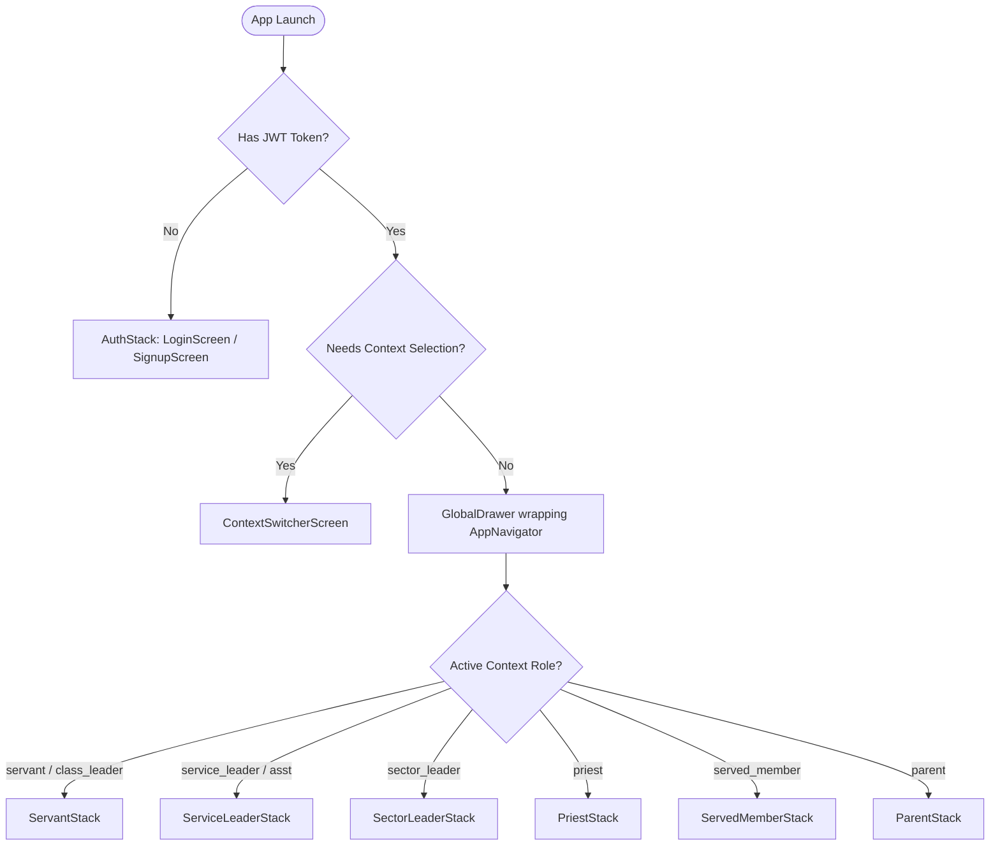

# Church Ministry Management System — Mobile Architecture & Technical Guide

> **Application Name:** Khedma App (خدمتي)  
> **Platform:** React Native 0.73.6, Expo SDK 50 (Cross-Platform iOS & Android)  
> **Primary Language:** TypeScript 5.3  
> **Design Philosophy:** Lovable-Inspired Warm Paper Aesthetic, Arabic-First Interface with Full RTL Support  
> **Target Audience:** Mobile Developers, UI/UX Designers, QA Engineers, System Architects  

---

## 1. Architectural Overview & Philosophy

The Khedma Mobile App is a multi-role, context-aware companion application for Orthodox Church Sunday School and pastoral ministry. It empowers everyone involved in church service — priests, sector leaders, service leaders, class servants, parents, and youth — within a single, unified client.

### 1.1 Core Principles

1. **Context-Aware Adaptive Navigation**:
   - A single user account can hold multiple church roles simultaneously (e.g., Servant in 3rd Primary, Service Leader in Preparatory, and Parent of children in Kindergarten).
   - The app dynamically switches navigation stacks, tab bars, and drawer menus according to the user's **Active Context** without requiring logout or password re-entry.

2. **Arabic-First Design with Authentic Ecclesiastical Vocab**:
   - Crafted natively for Arabic speakers with complete Right-to-Left (RTL) layout mirroring.
   - Utilizes genuine Coptic Orthodox ecclesiastical terminology (الخدمة، الافتقاد، طايو، أمين القطاع، أمين الخدمة، تحضير الدرس).

3. **Lovable-Inspired Design System**:
   - Clean, paper-like aesthetic featuring warm cream canvases (`#f7f4ed`), deep charcoal typography (`#1c1c1c`), subtle opacity borders, gold accents (`#d4a843`), and crimson highlights (`#9b1b30`).

4. **Resilience & Offline Preparedness**:
   - An offline mutation queue (`utils/offline.ts`) stores actions when connectivity drops and dispatches them upon reconnecting.
   - Local caching via `@react-native-async-storage/async-storage`.

5. **Integrated Push Notifications**:
   - Native device notifications via `expo-notifications` for real-time alerts on attendance reminders, lesson preparation reviews, and visitation tasks.

---

## 2. Technology Stack & Key Dependencies

```
┌─────────────────────────────────────────────────────────────┐
│                 React Native (Expo SDK 50)                  │
│  ┌─────────────────────────┐   ┌─────────────────────────┐  │
│  │   React Navigation 6    │   │   Redux Toolkit 2.0     │  │
│  │  (Stack, Tabs, Drawer)  │   │  (Auth, Church, Locale) │  │
│  └─────────────────────────┘   └─────────────────────────┘  │
│  ┌─────────────────────────┐   ┌─────────────────────────┐  │
│  │   Axios + Interceptors  │   │   Offline Mutation Queue│  │
│  │  (Auto-Auth & Church-ID)│   │  (AsyncStorage Backup)  │  │
│  └─────────────────────────┘   └─────────────────────────┘  │
│  ┌─────────────────────────┐   ┌─────────────────────────┐  │
│  │   Expo Push Tokens      │   │   Custom UI Kit         │  │
│  │  (Foreground/Background)│   │  (Lovable Design System)│  │
│  └─────────────────────────┘   └─────────────────────────┘  │
└──────────────────────────────┬──────────────────────────────┘
                               │
                               ▼
┌─────────────────────────────────────────────────────────────┐
│            Backend REST API (NestJS / Express)              │
│               Header: X-Church-ID & JWT Bearer              │
└─────────────────────────────────────────────────────────────┘
```

| Layer | Package | Version | Purpose |
|---|---|---|---|
| **Core Runtime** | `expo`, `react-native` | `~50.0.0` / `^0.73.6` | Mobile framework and cross-platform native runtime |
| **Language** | `typescript` | `^5.3.0` | Strict type safety across components, navigation, and API |
| **Navigation** | `@react-navigation/native`, `@react-navigation/bottom-tabs`, `@react-navigation/native-stack` | `^6.1.18` / `^6.5.0` / `^6.9.0` | Stack and tab navigation hierarchies |
| **State Management** | `@reduxjs/toolkit`, `react-redux` | `^2.0.0` / `^9.0.0` | Global state slices (auth, context, notifications, church, locale) |
| **Networking** | `axios` | `^1.6.0` | HTTP client with automatic header injection and error handling |
| **Local Storage** | `@react-native-async-storage/async-storage` | `1.21.0` | Local tokens, current context, and offline queue storage |
| **Push Notifications** | `expo-notifications`, `expo-device`, `expo-constants` | `^0.27.8` / `~5.9.4` | Push token registration and push notification handlers |
| **File Sharing & System**| `expo-file-system`, `expo-sharing` | `~16.0.9` / `~11.10.0` | Downloading and opening Excel reports and preparation attachments |
| **UI & Icons** | `@expo/vector-icons`, `react-native-vector-icons` | `^14.0.0` / `^10.0.0` | Ionicons vector iconography |
| **Gestures & Screens** | `react-native-gesture-handler`, `react-native-screens`, `react-native-safe-area-context` | `^2.14.1` / `~3.29.0` / `4.8.2` | Native transitions, drawer sliding, and safe area insets |

---

## 3. Directory & File Structure

```
mobile/
├── App.tsx                             # Application root: Redux Provider, Locale init, RootNavigator
├── index.js                            # React Native app entry registration
├── app.json                            # Expo configuration, permissions, plugins, icons, EAS project ID
├── eas.json                            # EAS build configuration (development, preview, production)
├── src/
│   ├── api/                            # Strongly-typed API client and endpoint modules
│   │   ├── client.ts                   # Axios client with request/response interceptors & X-Church-ID
│   │   ├── auth.api.ts                 # /auth/login, /auth/switch-context, /auth/contexts
│   │   ├── attendance.api.ts           # Attendance sessions, bulk records, attendance reports
│   │   ├── church.api.ts               # Sectors, services, stage groups, classes, enrollments
│   │   ├── dashboard.api.ts            # Servant, Leader, Priest, Member dashboard stats
│   │   ├── follow-ups.api.ts           # Eftekad: groups, weekly lists, activities, attention list
│   │   ├── preparations.api.ts         # Lesson preparations, uploads, reviews, comments
│   │   ├── tasks.api.ts                # Spiritual tasks, assignments, completion, verification
│   │   ├── taio.api.ts                 # Taio point balance, awards, leaderboard, store redemptions
│   │   ├── lesson-library.api.ts       # Master curriculum lessons repository
│   │   ├── activities.api.ts           # Activity groups, enrollments, sessions, attendance
│   │   ├── achievements.api.ts         # Member badges, criteria verification
│   │   ├── events.api.ts               # Church events, registrations, installment payments
│   │   ├── family.api.ts               # Family units and child profiles
│   │   ├── notifications.api.ts        # In-app notifications, FCM device registration
│   │   ├── servant-assignments.api.ts  # Class and service leader assignments
│   │   └── children.api.ts             # Parent-child tracking
│   ├── store/                          # Redux Toolkit global store configuration
│   │   ├── index.ts                    # Root reducer and TypeScript store types
│   │   ├── auth.slice.ts               # Tokens, user profile, roles, activeContext, context selection
│   │   ├── church.slice.ts             # Active church, sectors, services, current service year
│   │   ├── notifications.slice.ts      # Notifications list and unread count badge
│   │   └── locale.slice.ts             # Active language ('ar' / 'en') and RTL state
│   ├── navigation/                     # Navigation hierarchies and role stacks
│   │   ├── RootNavigator.tsx           # Authentication gating & GlobalDrawer wrapper
│   │   ├── AppNavigator.tsx            # Role-based stack selector
│   │   ├── AuthStack.tsx               # Login, Signup, ContextSwitcher
│   │   ├── CustomTabBar.tsx            # Role-aware bottom tab bar with "More" drawer trigger
│   │   ├── types.ts                    # Navigation prop & route params TypeScript interfaces
│   │   └── stacks/                     # Role-specific tab navigators
│   │       ├── ServantStack.tsx        # Servant & Class Leader experience
│   │       ├── ServiceLeaderStack.tsx  # Service Leader & Assistant experience
│   │       ├── SectorLeaderStack.tsx   # Sector Leader experience
│   │       ├── PriestStack.tsx         # Priest church-wide oversight experience
│   │       ├── ServedMemberStack.tsx   # Student / Member experience
│   │       ├── ParentStack.tsx         # Parent family monitoring experience
│   │       └── FollowUpStack.tsx       # Nested stack for pastoral visitation (Eftekad)
│   ├── screens/                        # 37 Application screens
│   │   ├── auth/                       # LoginScreen, SignupScreen, ContextSwitcherScreen
│   │   ├── servant/                    # Dashboard, Attendance, MyStudents, Preparation, Taio, Tasks
│   │   ├── service-leader/             # Dashboard, ClassManagement, ServantManagement, StudentsManagement
│   │   ├── sector-leader/              # Dashboard, SectorManagementScreen
│   │   ├── priest/                     # DashboardScreen
│   │   ├── served-member/              # Dashboard, TaioBalance, Tasks
│   │   ├── parent/                     # ChildrenScreen, ChildDetailScreen, EventsScreen
│   │   ├── leader/                     # PreparationsReviewScreen, ReportsScreen
│   │   ├── follow-up/                  # FollowUpList, FollowUpDetail, AddActivity, AttentionList...
│   │   ├── lesson-library/             # LessonLibraryScreen
│   │   ├── activities/                 # ActivitiesListScreen
│   │   ├── achievements/               # AchievementsScreen
│   │   └── shared/                     # NotificationsScreen, StoreScreen
│   ├── components/                     # Reusable UI component kit
│   │   ├── GlobalDrawer.tsx            # Custom right-sliding RTL drawer with role menus
│   │   ├── AppHeader.tsx               # Screen navigation header with back button & titles
│   │   ├── ContextCard.tsx             # Visual card showing active service and class scope
│   │   ├── CalendarPicker.tsx          # Custom month and day selector
│   │   └── ui/                         # Atomic design UI elements (AppButton, AppCard, AppInput...)
│   ├── hooks/                          # Custom utility and state hooks
│   │   ├── useAuth.ts                  # Login, logout, credentials dispatch
│   │   ├── useActiveContext.ts         # Active role flags (isServant, isLeader...) and scope IDs
│   │   ├── useLocale.ts                # Translation function t(...) and language state
│   │   └── usePushNotifications.ts     # Expo push token registration and notification listeners
│   ├── theme/                          # Lovable design system style tokens
│   │   ├── colors.ts                   # Cream, Charcoal, LightCream, Gold, Crimson, Opacity grays
│   │   ├── typography.ts               # Type scale (displayHero, sectionHeading, body...)
│   │   ├── spacing.ts                  # Standardized 4px-56px spacing tokens
│   │   ├── borderRadius.ts             # Border radiuses (sm: 4, md: 6, lg: 8, xl: 12, full: 9999)
│   │   └── shadows.ts                  # Elevation tokens for card depth
│   ├── locales/                        # Internationalization resources
│   │   ├── ar.ts                       # Arabic translations (340+ keys)
│   │   ├── en.ts                       # English translations
│   │   └── index.ts
│   ├── services/
│   │   └── pushNotifications.ts        # Expo notifications channel setup and permission management
│   └── utils/
│       ├── offline.ts                  # Offline mutation queue with AsyncStorage persistence
│       └── storage.ts                  # Secure & local storage helper methods
```

---

## 4. State Management (Redux Toolkit Architecture)

The app's global state is governed by Redux Toolkit across four modular slices:

```
┌────────────────────────────────────────────────────────┐
│                   Redux Root State                     │
│                                                        │
│  ┌───────────────────┐        ┌───────────────────┐    │
│  │    auth.slice     │        │   church.slice    │    │
│  │  - token          │        │  - sectors        │    │
│  │  - refreshToken   │        │  - services       │    │
│  │  - user           │        │  - currentYear    │    │
│  │  - memberId       │        └───────────────────┘    │
│  │  - roles []       │        ┌───────────────────┐    │
│  │  - contexts []    │        │notifications.slice│    │
│  │  - activeContext  │        │  - list []        │    │
│  │  - needsContext   │        │  - unreadCount    │    │
│  └───────────────────┘        └───────────────────┘    │
│                               ┌───────────────────┐    │
│                               │   locale.slice    │    │
│                               │  - language ('ar')│    │
│                               │  - isRTL (true)   │    │
│                               └───────────────────┘    │
└────────────────────────────────────────────────────────┘
```

### 4.1 `auth.slice.ts`

Manages token persistence, user credentials, and context switching:

- **`setCredentials`**: Stores access/refresh tokens, user profile, available roles, and contexts upon login. If `contexts.length > 1`, triggers `needsContextSelection = true`.
- **`switchContext`**: Replaces the active context with the newly chosen role and scope, updates the access token, and sets `needsContextSelection = false`.
- **`logout`**: Resets all authentication state, clears AsyncStorage keys (`access_token`, `refresh_token`), and returns to `LoginScreen`.

### 4.2 Custom State Hooks

- **`useActiveContext()`**: Memoizes and computes boolean helpers for rendering:
  ```typescript
  const {
    role,               // e.g. 'servant'
    scope,              // { serviceId: 1, classId: 2 }
    isServant,          // boolean
    isClassLeader,      // boolean
    isServiceLeader,    // boolean
    isSectorLeader,     // boolean
    isPriest,           // boolean
    isParent,           // boolean
    isServedMember,     // boolean
    serviceId,          // number | undefined
    classId,            // number | undefined
  } = useActiveContext();
  ```
- **`useAuth()`**: Exposes `login()`, `logout()`, `switchContext()`, and loading states.
- **`useLocale()`**: Exposes `t(key, params)` for nested string lookups and `isRTL` flag.

---

## 5. Navigation Architecture & Dynamic Role-Based Routing

### 5.1 Root Navigation Flow (`RootNavigator.tsx`)



### 5.2 The Global Drawer (`GlobalDrawer.tsx`)

The app features a custom right-sliding drawer built with React Native's native animated driver, strictly tailored for RTL layouts:
- **Header**: Displays user avatar, full name, and current role in Arabic.
- **Context Card**: Shows current service/class scope with a direct **تبديل (Switch)** button leading to `ContextSwitcherScreen`.
- **Role-Filtered Menu Groups**:
  - *Servant Menu*: الرئيسية (Home), إعداد الدرس (Preparations), الحضور (Attendance), مخدوميّ (My Students), المهام (Tasks), المتابعة (Follow-up), مكتبة الدروس (Library), الإنجازات (Achievements), نقاط طايو (Taio).
  - *Service Leader Menu*: الرئيسية (Home), اعتماد تحضيرات الدروس (Review Preps), تقارير المرحلة (Reports), سجلات الحضور (Attendance).
  - *Sector Leader Menu*: الرئيسية (Home), إدارة خدمات وخدام القطاع (Sector Management), تقارير القطاع (Sector Reports), مراجعة التحضيرات (Reviews).
  - *Priest Menu*: الرئيسية (Home), إدارة القطاعات والخدمات (Sectors & Services), التقارير الشاملة (Church Reports), مراجعة التحضيرات (Reviews).
  - *Served Member Menu*: الرئيسية (Home), مهامي (My Tasks), رصيدي (My Points), المتجر (Store).
- **Footer**: Logout button with crimson styling.

### 5.3 Custom Bottom Tab Bar (`CustomTabBar.tsx`)

Each role stack displays a streamlined 4-tab bottom bar tailored to the most urgent daily actions, plus a 5th tab labeled **المزيد (More)** which triggers the `GlobalDrawer`.

---

## 6. Design System & Component Library

The mobile user interface follows a Lovable-inspired design language with warm, tactile tones:

### 6.1 Color Palette Tokens (`theme/colors.ts`)

| Token | Hex / Value | Description |
|---|---|---|
| `cream` | `#f7f4ed` | Core background canvas, card surfaces, bottom navigation |
| `charcoal` | `#1c1c1c` | High-contrast headings, primary buttons, active icons |
| `offWhite` | `#fcfbf8` | Light text on dark surfaces, input backgrounds |
| `lightCream` | `#eceae4` | 1px border strokes, dividers, table outlines |
| `mutedGray` | `#5f5f5d` | Secondary subtitles, timestamps, placeholder text |
| `gold` | `#d4a843` | Taio gamification accents, highlight badges, context switch |
| `navy` | `#192f5f` | Deep ecclesiastical blue used in drawer background |
| `crimson` | `#9b1b30` | Danger actions, logout buttons, unenrollment |
| `success` | `#2e7d32` | Present attendance, approved preparations, completed tasks |
| `warning` | `#e65100` | Late attendance, pending review, draft status |
| `error` | `#c62828` | Absent attendance, rejected lesson, insufficient points |

### 6.2 Typography Tokens (`theme/typography.ts`)

- **`displayHero`**: 36px, Weight 700, LineHeight 1.10 — Bold statistics & dashboard welcomes
- **`sectionHeading`**: 28px, Weight 600, LineHeight 1.15 — Screen titles
- **`subHeading`**: 22px, Weight 600, LineHeight 1.20 — Section headers
- **`cardTitle`**: 18px, Weight 600, LineHeight 1.25 — Card and list item titles
- **`bodyLarge`**: 17px, Weight 400, LineHeight 1.40 — Primary reading copy
- **`body`**: 15px, Weight 400, LineHeight 1.50 — Regular descriptive text
- **`button`**: 15px, Weight 500, LetterSpacing 0.3px — Standard button text
- **`buttonSmall`**: 13px, Weight 500 — Action pills and tag buttons
- **`caption`**: 13px, Weight 400, LineHeight 1.40 — Subtitles, dates, helper text
- **`overline`**: 11px, Weight 600, LetterSpacing 1.0px — Category labels

### 6.3 Reusable UI Kit (`components/ui/`)

- **`AppButton`**: Supports variants (`primary`, `secondary`, `ghost`, `danger`, `success`), loading spinner state, and disabled styles.
- **`AppCard`**: Cream-colored bordered container (`#f7f4ed`) with 1px light cream border (`#eceae4`), 8px border radius, and flat elevation.
- **`AppInput`**: RTL-aware text input with label, floating placeholder, focus border ring, and error text.
- **`AppHeader`**: Standardized screen header with back arrow, dynamic title, and right action slot.
- **`AppBadge`**: Colored pill for status indication (active, pending, approved, absent).
- **`AppAvatar`**: Circular user profile badge with fallback to member's initials.
- **`AppModal` & `AppBottomSheet`**: Accessible animated modals and bottom dialogs.
- **`AppListItem`**: Unified list element supporting leading icon, title, subtitle, and trailing arrow/action.
- **`AppEmptyState`**: Centered empty feedback with large 48px muted icon, title, and action button.
- **`CalendarPicker`**: Custom date selector allowing servants to select Sunday School dates.
- **`ContextCard`**: Displays current active role, service name, and class name with switch shortcut.

---

## 7. Complete Screen Catalog (37 Screens)

### 7.1 Authentication Screens
1. **`LoginScreen`** (`screens/auth/LoginScreen.tsx`):
   - Identifier field (email, username, or phone number) and password.
   - Tenant-aware authentication via `authApi.login()`.
   - Stores JWT and tokens in AsyncStorage; dispatches `setCredentials`.
2. **`SignupScreen`** (`screens/auth/SignupScreen.tsx`):
   - Full name, username, phone, gender, and password.
   - For youth self-onboarding (when enabled).
3. **`ContextSwitcherScreen`** (`screens/auth/ContextSwitcherScreen.tsx`):
   - Displays all contexts authorized for the member with role labels and service names.
   - One-tap selection dispatches `switchContext` and immediately updates the app layout.

### 7.2 Servant Screens (`screens/servant/`)
4. **`DashboardScreen`**:
   - Quick attendance stats, pending lesson preparation status, today's schedule.
   - Quick action buttons: تسجيل حضور (Take Attendance), تحضير درس (Prepare Lesson), إضافة نقاط (Award Points).
5. **`AttendanceScreen`**:
   - Date selector for Sunday School session.
   - Student roll call list with quick status toggles: **حاضر (Present)**, **غائب (Absent)**, **متأخر (Late)**, **معذور (Excused)**.
   - Bulk save via `POST /attendance/sessions/:id/records`.
6. **`MyStudentsScreen`**:
   - Roster of all students enrolled in the servant's assigned class.
   - Detailed student card: phone number, birth date, attendance rate %, and Taio points.
   - Quick call/WhatsApp buttons and add student modal.
7. **`PreparationScreen`**:
   - Create and edit lesson preparation plans: scripture reference, objectives, lesson points, and application.
   - File attachment uploader (Multer upload integration).
   - Submit for leader review (`POST /preparations/:id/submit`).
   - Revision discussion thread (`GET /preparations/:id/comments`).
8. **`TaioAwardScreen`**:
   - Select student from class and award points with pre-defined or custom reasons (e.g., memorizing Bible verse, church behavior).
   - Instantly updates student points ledger.
9. **`TasksScreen`**:
   - List of spiritual and church tasks created for the class.
   - Add new task with points value and due date.
10. **`TaskDetailScreen`**:
    - Detailed view of student submissions for a task.
    - Servant verifies completion (`verifyTask`) which automatically awards Taio points to the student.

### 7.3 Service Leader Screens (`screens/service-leader/`)
11. **`DashboardScreen`**:
    - High-level KPIs: total students enrolled, total servants assigned, average attendance %, preparation submission rate %.
12. **`ClassManagementScreen`**:
    - Full list of classes in the service (e.g., 3rd Primary A, 3rd Primary B).
    - Create new class, modify class name, and assign class leaders.
13. **`ServantManagementScreen`**:
    - List of all servants serving in the stage.
    - Servant reassignment between classes, servant performance overview.
14. **`StudentsManagementScreen`**:
    - Stage-wide student directory with class filters.
    - Enroll new students, transfer students between classes, unenroll students.

### 7.4 Sector Leader Screens (`screens/sector-leader/`)
15. **`DashboardScreen`**:
    - Macro-level overview of the entire sector (e.g., Primary Sector covering grades 1 through 6).
    - Cross-service comparisons, overall attendance trends.
16. **`SectorManagementScreen`**:
    - Manage services and stage groups within the sector.
    - Assign service leaders and assistant service leaders.

### 7.5 Priest Screens (`screens/priest/`)
17. **`DashboardScreen`**:
    - Church-wide pastoral dashboard: total active members, sector metrics, high-level reports.
    - Pastoral access to all sectors and services.

### 7.6 Shared Leader Screens (`screens/leader/`)
18. **`PreparationsReviewScreen`**:
    - Inbox of lesson preparations submitted by servants awaiting approval.
    - Review preparation content, scripture references, and attached files.
    - **Approve (اعتماد)** or **Reject (إعادة للمراجعة)** with specific pastoral feedback comments.
19. **`ReportsScreen`**:
    - Multi-category report viewer:
      - Attendance Reports over date ranges.
      - Taio points distribution.
      - Servant performance metrics.
      - Eftekad visitation completion rates.
    - **One-tap export to Excel (.xlsx)**: Downloads spreadsheet and opens native share sheet via `expo-sharing`.

### 7.7 Served Member (Student / Youth) Screens (`screens/served-member/`)
20. **`DashboardScreen`**:
    - Welcome hero with student name and accumulated Taio points balance.
    - My upcoming spiritual tasks, current attendance streak, and recent achievements.
21. **`TaioBalanceScreen`**:
    - Visual points wallet.
    - Full transaction history ledger (points earned from attendance, tasks, awards, and spent in store).
    - Church leaderboard ranking.
22. **`TasksScreen`**:
    - Active spiritual tasks assigned by the servant (Bible readings, prayers, hymn memorization).
    - Complete task action: marks task submitted for servant verification.

### 7.8 Parent Screens (`screens/parent/`)
23. **`ChildrenScreen`**:
    - List of children linked to the parent's household.
    - Child cards showing class name, attendance %, and current points.
24. **`ChildDetailScreen`**:
    - In-depth view into a child's spiritual progress: attendance log, completed tasks, and servant contact info.
25. **`EventsScreen`**:
    - Upcoming church retreats, trips, and camps.
    - Register children and track installment payments.

### 7.9 Eftekad (Pastoral Follow-Up) Screens (`screens/follow-up/`)
26. **`FollowUpListScreen`**:
    - Overview of assigned visitation groups and follow-up families.
    - Status tabs: نشط (Active), مؤقت (Paused), مكتمل (Completed).
27. **`FollowUpDetailScreen`**:
    - Group details, member list, and historical contact log.
28. **`CreateFollowUpScreen`**:
    - Create a new follow-up group, designate responsible servant, and add target members.
29. **`AddActivityScreen`**:
    - Log a visitation contact:
      - Type: اتصال هاتفي (Phone Call), زيارة منزلية (Home Visit), مقابلة بالكنيسة (Church Meeting), رسالة (Message), ملاحظة (Note).
      - Date, notes, and outcome.
30. **`AttentionListScreen` (يحتاجون متابعة)**:
    - **Algorithmic absentee flagging**: Automatically lists students absent for 2 or more consecutive weeks.
    - One-tap button to initiate call or assign immediate follow-up.
31. **`ManageGroupsScreen`**:
    - Reorder, group, or reorganize follow-up clusters.
32. **`MonitoringScreen`**:
    - Supervisory metrics for service leaders to monitor which servants completed their weekly visits.

### 7.10 Shared Cross-Role Screens (`screens/shared/`)
33. **`NotificationsScreen`**:
    - Chronological list of in-app notifications.
    - Tap to mark as read, pull-to-refresh, mark all as read.
34. **`StoreScreen`**:
    - Reward store item catalog with point costs and stock quantity.
    - Purchase/redeem reward item using accumulated Taio points.
    - View redemption history and delivery status.
35. **`LessonLibraryScreen`** (`screens/lesson-library/`):
    - Searchable archive of church lessons, categorized by spiritual theme and grade.
    - View curriculum guidelines, objectives, and sample activities.
36. **`ActivitiesListScreen`** (`screens/activities/`):
    - Church clubs and extracurriculars (Choir, Scouts, Hymns, Drama, Sports).
    - Enrollment and meeting schedules.
37. **`AchievementsScreen`** (`screens/achievements/`):
    - Gamified badges showcase (e.g., "10 Weeks Perfect Attendance", "Scripture Master").
    - Locked vs unlocked badges with progress indicators.

---

## 8. Networking, Offline Support & Device Integration

### 8.1 API Client Interceptor Pipeline (`api/client.ts`)

Every HTTP request dispatched from the mobile application automatically includes required tenancy and security headers:

```typescript
apiClient.interceptors.request.use(async (config) => {
  // 1. Inject Bearer Token
  const token = await AsyncStorage.getItem("access_token");
  if (token) {
    config.headers.Authorization = `Bearer ${token}`;
  }
  // 2. Inject Multi-Tenant Header
  const churchId = await AsyncStorage.getItem("church_id");
  if (churchId) {
    config.headers["X-Church-ID"] = churchId;
  }
  return config;
});
```

- **Automatic 401 Session Handling**:
  If the API responds with `401 Unauthorized`, the interceptor clears stored tokens (`access_token`, `refresh_token`), forcing the navigation container to transition smoothly back to `LoginScreen`.

### 8.2 Offline Mutation Queue (`utils/offline.ts`)

For servants taking attendance in church basements or areas with weak reception, the app provides an offline mutation queue:

```typescript
export interface PendingMutation {
  id: string;
  endpoint: string;
  method: 'POST' | 'PUT' | 'PATCH' | 'DELETE';
  data?: any;
  createdAt: string;
  retryCount: number;
}
```

- Actions performed while offline are queued in AsyncStorage (`pending_mutations`).
- When connectivity resumes, the queue flushes requests sequentially.

### 8.3 Push Notifications (`services/pushNotifications.ts`)

- **Permissions & Registration**:
  Requests user permission via `Notifications.requestPermissionsAsync()`.
  On Android, configures the `default` notification channel with high priority and vibration pattern.
- **Backend Registration**:
  Extracts the Expo Push Token and transmits it to `POST /notifications/register-device` alongside the device OS (`ios` / `android`).
- **Foreground & Background Listeners**:
  Configured to display native alert banners even while the user is actively using the application.

---

## 9. Localization & RTL (Arabic-First)

The application is built Arabic-first with full English fallback (`locales/ar.ts` and `locales/en.ts`):

- **Layout Direction**: All horizontal layouts utilize logical flex properties (`direction: 'rtl'`, `marginStart`, `marginEnd`, `alignSelf: 'flex-start'`).
- **Icons & Arrows**: Back chevron icons reverse direction automatically in RTL mode.
- **Drawer Placement**: Slides from the natural physical right side under forced RTL mode.
- **Dynamic Terminology**: Role labels, titles, and button prompts are resolved dynamically via `useLocale().t('key')`.

---

## 10. Development, Testing & Build Guide

### 10.1 Running Locally with Expo Go

```bash
cd mobile
npm install

# Start the Expo development server
npx expo start
```

> **Testing on Physical Device:**  
> When testing on a real phone via Expo Go, open `src/api/client.ts` and set the `HOST` constant to your local machine's LAN IP (e.g. `192.168.1.100` or `10.160.168.172`), ensuring both computer and phone are connected to the same Wi-Fi network.

### 10.2 Android & iOS Production Builds (EAS)

The project includes pre-configured `eas.json` profiles:

```bash
# Build standalone Android APK for direct testing
eas build --platform android --profile preview

# Build production Android App Bundle (AAB) for Google Play
eas build --platform android --profile production

# Build iOS archive for TestFlight / App Store
eas build --platform ios --profile production
```
